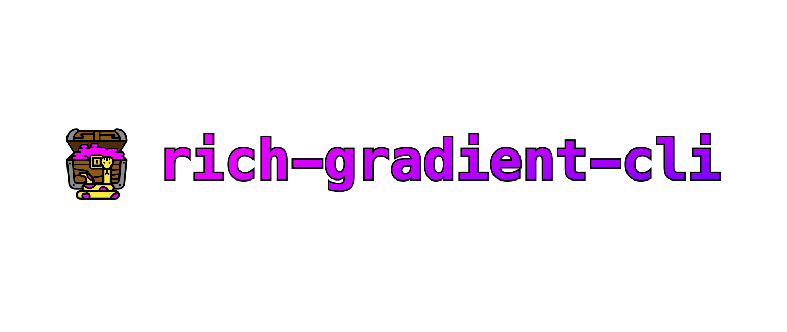

`gradient` prints text, files, URLs and stdin in your terminal with a color gradient. It is the command-line tool for [`rich-gradient`](https://github.com/maxludden/rich-gradient) and works like [`rich-cli`](https://github.com/Textualize/rich-cli): give it something to show and it picks how to render it.

```text
gradient [OPTIONS] [PATH,TEXT,URL, or '-']
```


## Installation

`rich-gradient-cli` requires [Python](https://www.python.org/) 3.11 or newer.

With [uv](https://github.com/astral-sh/uv):

```shell
uv tool install rich-gradient-cli
```

With [pip](https://pip.pypa.io/):

```shell
pip install rich-gradient-cli
```

With [Homebrew](https://brew.sh), trust the tap first (Homebrew won't load formulae from a third-party tap until you do):

```shell
brew tap maxludden/tap
brew trust maxludden/tap
brew install maxludden/tap/rich-gradient-cli
```

New releases reach the Homebrew tap about a day after PyPI.

## Usage

Pass literal text, a file path, an `http(s)` URL, or `-` to read stdin:

```bash
gradient --colors 'red,#ff9900,#ffff00' "Gradient text that runs red, orange, yellow!"
gradient README.md                       # a file
gradient https://example.com/page.md     # a URL
cat notes.txt | gradient -               # stdin
```

### What gets rendered

The file extension picks the renderable. A mode flag overrides it.

| Input | Rendered as | Flag to force it |
|---|---|---|
| Literal text, stdin, `.txt` | Gradient text (Rich markup is parsed) | `-p`, `--print` |
| `.md`, `.markdown` | Markdown | `-m`, `--markdown` |
| `.rst` | reStructuredText | `--rst` |
| `.ipynb` | Jupyter notebook | `--ipynb` |
| `.json` | Pretty-printed JSON | `-J`, `--json` |
| `.csv`, `.tsv` | Table | `--csv` |
| Any other file | Syntax-highlighted code | `--syntax` |

Some modes are only available as flags: `--tree` (a directory, or lines of text, as a tree), `-u`/`--rule` (a rule titled with the text), `--columns`, `--spectrum` (the color palette) and `--inspect` (a Python object).

### Examples

```bash
gradient pyproject.toml -n -g                 # code with line numbers and indent guides
gradient data.csv --colors cyan,magenta       # CSV as a table
cat doc.rst | gradient - --rst                # reStructuredText from stdin
gradient "Title" --rule --colors blue,cyan    # a gradient rule
gradient "Heads up" --panel rounded --title Notice
gradient --tree src                           # a directory tree
gradient str --inspect                        # inspect a Python object
gradient --spectrum                           # show the full palette
gradient README.md --export-svg readme.svg    # also save as SVG (or -o file.html)
```

### Options at a glance

Options shared with `rich-cli` keep the same spelling, and gradient options are long-only. Note that `-h` means `--head`, so use `--help` for help.

| Group | Options |
|---|---|
| Gradient | `--colors`, `--bgcolors`, `--rainbow`, `--hues`, `--repeat-scale`, `--highlight-word`, `--highlight-regex`, `--animate`, `--duration` |
| Layout | `-l`/`-c`/`-r` align the block, `-L`/`-C`/`-R`/`-F` justify text, `-w`/`-W` width, `-e` expand, `-d` padding, `-a BOX` panel, `-S` panel style, `--border-only`, `--title`, `--caption` |
| Content | `-s` style, `--no-markup`, `-j` emoji, `-y` hyperlinks, `-h`/`-t` head/tail, `-x` lexer, `--theme`, `-n` line numbers, `-g` guides |
| Output | `-o`/`--export-html`, `--export-svg`, `--pager`, `--force-terminal`, `-v`/`--version` |

Run `gradient --help` for the full list, or read the [options reference](https://maxludden.github.io/rich-gradient-cli/options/).

### Upgrading from 0.3

Versions up to 0.3 used subcommands (`gradient print`, `gradient panel`, `gradient view`, ...). These are now flags on the single `gradient` command. The [CHANGELOG](https://github.com/maxludden/rich-gradient-cli/blob/master/CHANGELOG.md) maps each old subcommand to its new flag.

### Telemetry

Anonymous usage telemetry is **off by default**. Use `gradient --telemetry enable|disable|status` to manage it. Events are sent only if telemetry is enabled *and* `AMPLITUDE_API_KEY` is set. Each event is a `Command Run` with the render mode and a random install ID, sent after a command succeeds.

## Documentation

The full documentation is at **[maxludden.github.io/rich-gradient-cli](https://maxludden.github.io/rich-gradient-cli)**.

To preview it locally with [Zensical](https://zensical.org):

```bash
uv pip install -e ".[docs]"
zensical serve
```

<div align="center">
  <a href="https://github.com/maxludden/maxludden" style="text-decoration:none; color:inherit;">
      <p>Designed by Max Ludden</p>
  </a>
  <br />
  <a href="https://github.com/maxludden/maxludden" style="text-decoration:none; color:inherit;">
    
  </a>
</div>
