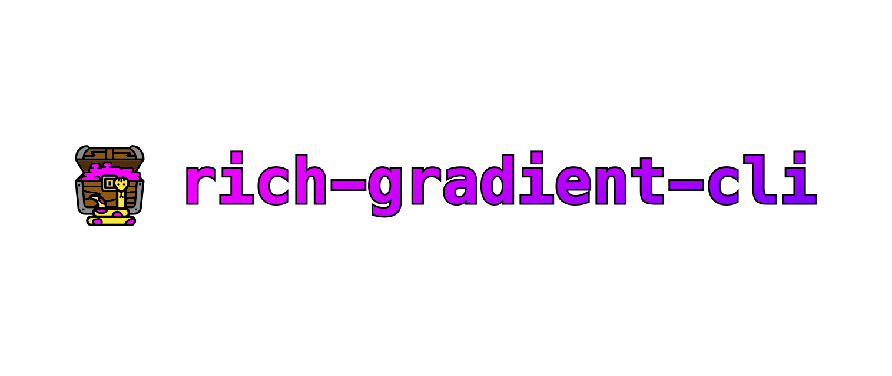

`gradient` prints text, files, URLs and stdin in your terminal with a color gradient. It is the command-line tool for [`rich-gradient`](https://github.com/maxludden/rich-gradient) and works like [`rich-cli`](https://github.com/Textualize/rich-cli): give it something to show and it picks how to render it.

```bash
uv tool install rich-gradient-cli
```

```bash
--8<-- "docs/snippets/commands/text.sh"
```


## How it works

- **One command.** Everything is `gradient [OPTIONS] [PATH,TEXT,URL, or '-']`. There are no subcommands.
- **Automatic rendering.** The file extension decides how a file is shown: Markdown, reStructuredText, a notebook, JSON, a CSV table, or syntax-highlighted code. A mode flag such as `--markdown` or `--tree` overrides it.
- **Familiar flags.** Layout, styling and export options use the same short flags as `rich-cli`.
- **Gradients everywhere.** `--colors`, `--bgcolors`, `--rainbow` and `--animate` work with every renderable.

## Next steps

- [Usage](usage.md) installs the tool and walks through an example of each renderable.
- [Options](options.md) lists every flag, with a screenshot of each one.
- [API](api.md) documents the Python modules behind the command.
