# Options

`gradient [OPTIONS] [PATH,TEXT,URL, or '-']` - the argument is a file, an `http(s)` URL, `-` for stdin, or literal text.
Run `gradient --help` for the grouped, always-current list. Shared flags use the same spelling as `rich-cli`; `-h` is `--head` (use `--help` for help).

## Renderable

Pick at most one (two is a usage error, exit code 2). With none, the renderable is chosen from the extension:
`.md`: Markdown, `.rst`: reStructuredText, `.ipynb`: notebook, `.json`: JSON, `.csv`/`.tsv`: table, other known files: syntax, literal text and stdin: text.

| Flag | Renders |
|---|---|
| `-p, --print` | Gradient text with Rich console markup |
| `-u, --rule` | A rule titled with the text |
| `-J, --json` | Pretty-printed JSON |
| `-m, --markdown` | Markdown |
| `--rst` | reStructuredText |
| `--csv` | CSV/TSV as a table |
| `--ipynb` | Jupyter notebook |
| `--syntax` | Syntax-highlighted code |
| `--inspect` | A Python object, e.g. `str` or `rich.console.Console` |
| `--tree` | A directory (or lines of text) as a tree |
| `--columns` | Each line as a column cell |
| `--spectrum` | The rich-gradient palette (`--spectrum-output table\|names\|hex\|csv`) |

## Gradient

`--colors` (env `GRADIENT_COLORS`), `--bgcolors`, `--rainbow`, `--hues`, `--repeat-scale`,
`--highlight-word WORD=STYLE`, `--highlight-regex PATTERN=STYLE` (the last two repeatable),
`--animate`, `--duration SECONDS`. Colors accept Rich names, hex (including `#abc`) and CSS names via rich-color-ext.

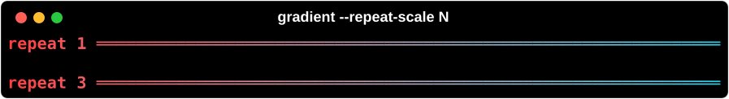

`--animate` and `--pager` need an interactive terminal, so they have no screenshot.

## Layout

`-l/--left`, `-c/--center`, `-r/--right` (block alignment); `-L/-C/-R/-F` (`--text-left/-center/-right/-full`) justify text;
`--vertical-align`; `-w/--width`, `-W/--max-width`; `-e/--expand` (default: auto - panels, Markdown and code fill the width, everything else shrinks to its content);
`-d/--padding T,R,B,L`; `-a/--panel BOX`, `-S/--panel-style`, `--title`, `--caption`.

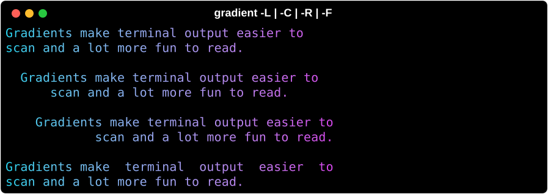

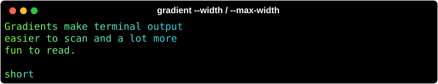

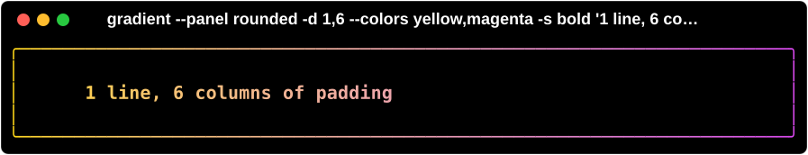

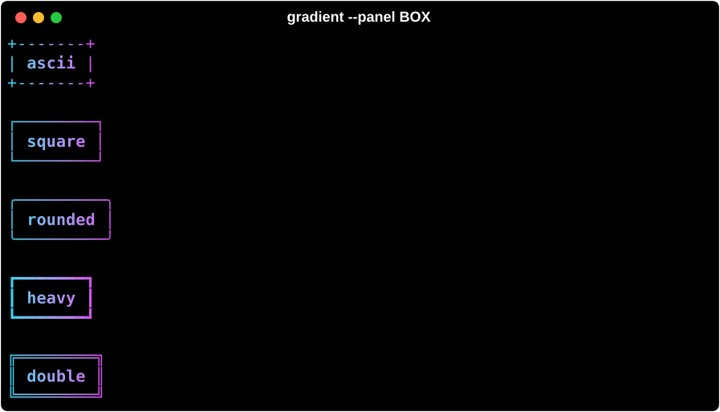

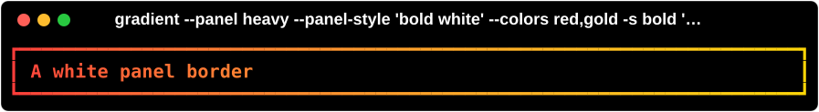

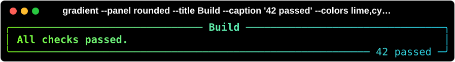

## Content

`-s/--style`, `--markup/--no-markup`, `-j/--emoji`, `-y/--hyperlinks`, `--no-wrap`, `--tab-size`,
`-h/--head N`, `-t/--tail N` (syntax, CSV, notebook), `-x/--lexer`, `--theme` (env `RICH_THEME`), `-n/--line-numbers`,
`-g/--guides`, `--rule-style`, `--rule-char`, `--thickness 0-3`, `--delimiter`, `--no-header`, `--max-depth` (tree).

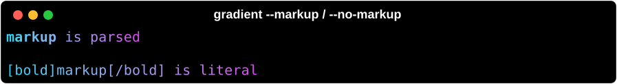

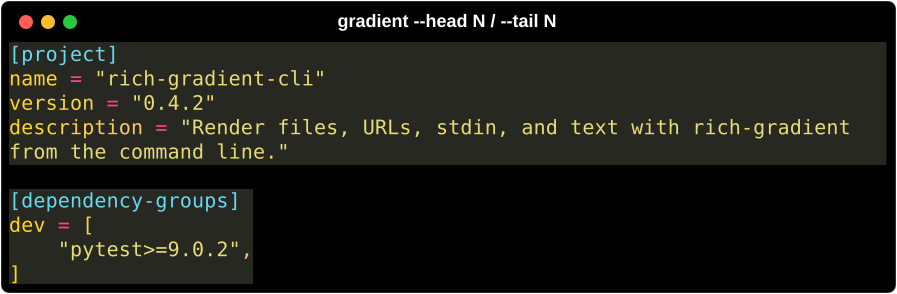

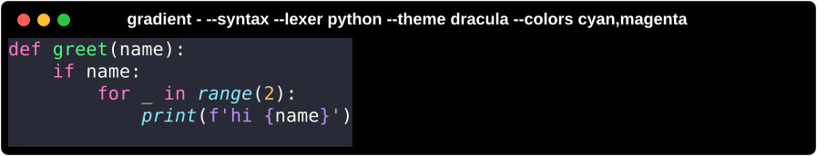

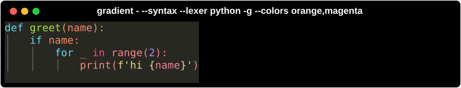

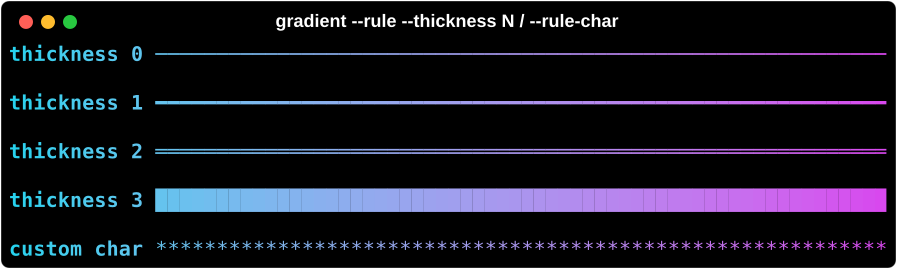

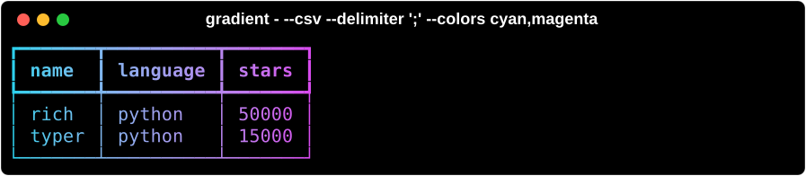

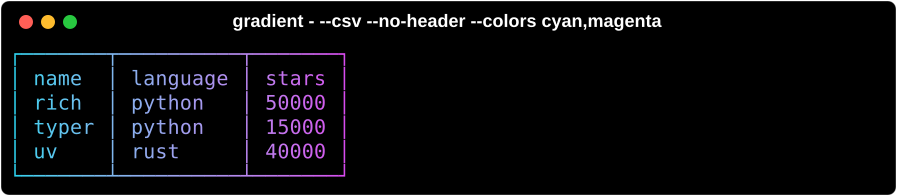

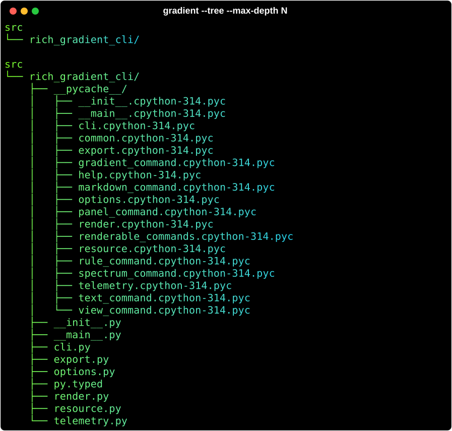

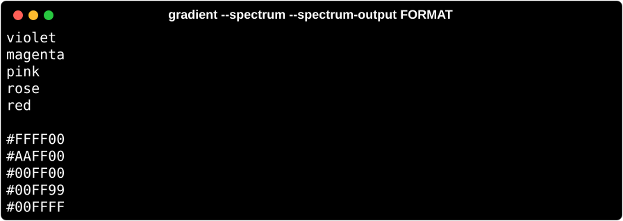

## Output

`-o/--export-html PATH`, `--export-svg PATH`, `--pager`, `--force-terminal`, `--telemetry enable|disable|status`, `-v/--version`.

## Exit codes

`0` success, `1` runtime error (unreadable file, HTTP failure, invalid JSON/markup, ...), `2` usage error.
