# Options

```text
gradient [OPTIONS] [PATH,TEXT,URL, or '-']
```

The argument is a file, an `http(s)` URL, `-` for stdin, or literal text. Run `gradient --help` for the always-current list.

```bash
--8<-- "docs/snippets/commands/help.sh"
```

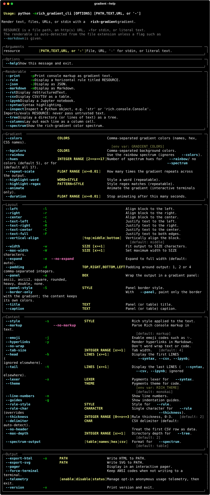

Options shared with `rich-cli` use the same spelling. Gradient options are long-only. `-h` means `--head`, so use `--help` for help.

## Renderable

Pick at most one of these. Giving two is a usage error. With none, the file extension decides: `.md` is Markdown, `.rst` is reStructuredText, `.ipynb` is a notebook, `.json` is JSON, `.csv`/`.tsv` is a table, and any other file is syntax-highlighted. Literal text, stdin and `.txt` files are printed as gradient text.

| Flag | Renders |
|---|---|
| `-p`, `--print` | Gradient text with Rich console markup |
| `-u`, `--rule` | A rule titled with the text |
| `-J`, `--json` | Pretty-printed JSON |
| `-m`, `--markdown` | Markdown |
| `--rst` | reStructuredText |
| `--csv` | CSV/TSV as a table |
| `--ipynb` | Jupyter notebook |
| `--syntax` | Syntax-highlighted code |
| `--inspect` | A Python object, e.g. `str` or `rich.console.Console` (imports/evaluates its argument: never pass untrusted text) |
| `--tree` | A directory (or lines of text) as a tree |
| `--columns` | Each line as a column cell |
| `--spectrum` | The rich-gradient color palette |

## Gradient

Colors can be Rich color names, hex codes (including the short `#abc` form) or CSS color names. An invalid color is a usage error.

| Option | Description |
|---|---|
| `--colors COLORS` | Comma-separated gradient colors. Can also be set with the `GRADIENT_COLORS` environment variable. |
| `--bgcolors COLORS` | Comma-separated background colors. |
| `--rainbow` | Use the full rainbow spectrum (ignores `--colors`). |
| `--hues N` | Number of spectrum hues (2-17) used by `--rainbow` and when no colors are given (default `5`), or shown by `--spectrum` (default all `17`). |
| `--repeat-scale N` | How many times the gradient repeats across the output. |
| `--highlight-word WORD=STYLE` | Style every occurrence of a word. Repeatable. |
| `--highlight-regex PATTERN=STYLE` | Style every regex match. Repeatable. |
| `--animate` | Animate the gradient (interactive terminals only). |
| `--duration SECONDS` | Stop animating after this many seconds. |

```bash
--8<-- "docs/snippets/options/colors.sh"
```


```bash
--8<-- "docs/snippets/options/bgcolors.sh"
```


```bash
--8<-- "docs/snippets/options/rainbow.sh"
```


```bash
--8<-- "docs/snippets/options/hues.sh"
```

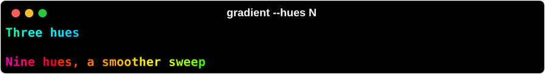

```bash
--8<-- "docs/snippets/options/repeat-scale.sh"
```

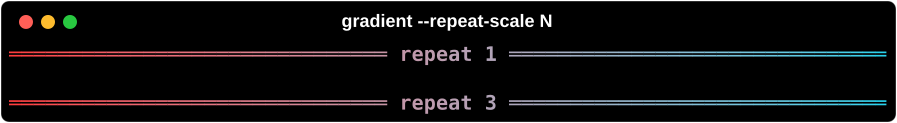

```bash
--8<-- "docs/snippets/options/highlight-word.sh"
```

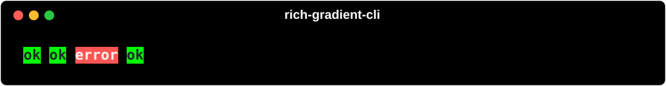

```bash
--8<-- "docs/snippets/options/highlight-regex.sh"
```

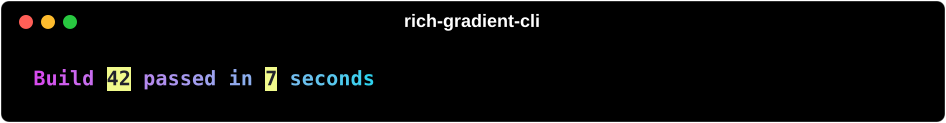

`--animate` and `--pager` need an interactive terminal, so they have no screenshot.

## Layout

| Option | Description |
|---|---|
| `-l`, `--left` / `-c`, `--center` / `-r`, `--right` | Align the whole block (default left). Rule titles default to center. |
| `-L`, `--text-left` / `-C`, `--text-center` / `-R`, `--text-right` / `-F`, `--text-full` | Justify the text inside the block (text and Markdown). |
| `--vertical-align top\|middle\|bottom` | Vertically align the block. Panels are always top-aligned. |
| `-w`, `--width SIZE` | Fit the output to SIZE characters. |
| `-W`, `--max-width SIZE` | Never be wider than SIZE characters. |
| `-e`, `--expand` / `--no-expand` | Fill the full width. By default panels, Markdown and code expand; everything else shrinks to its content. |
| `-d`, `--padding T,R,B,L` | Padding as 1, 2 or 4 comma-separated integers. |
| `-a`, `--panel BOX` | Wrap the output in a gradient panel: `ascii`, `ascii2`, `square`, `rounded`, `heavy`, `double` or `none`. |
| `-S`, `--panel-style STYLE` | Style of the panel border. A color (e.g. `red` or `bold white`) gives a solid border with the gradient on the content only; attributes alone (e.g. `bold`) keep the gradient border. |
| `--border-only` | With `--panel`, paint only the border (and its title) with the gradient. The content keeps its own colors. |
| `--title TEXT` | Panel title. Also used as a CSV table title, and as the rule title when no text is given. |
| `--caption TEXT` | Panel subtitle, or CSV table caption. |

```bash
--8<-- "docs/snippets/options/align.sh"
```

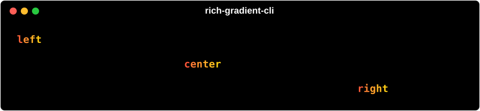

```bash
--8<-- "docs/snippets/options/text-align.sh"
```

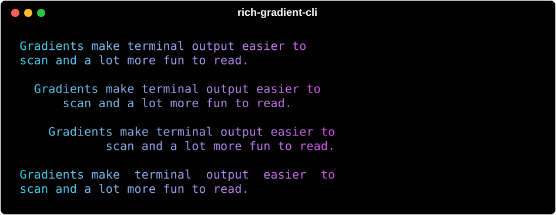

```bash
--8<-- "docs/snippets/options/width.sh"
```

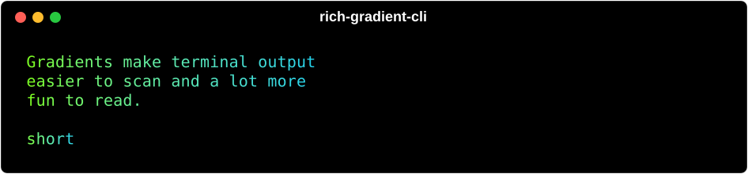

```bash
--8<-- "docs/snippets/options/expand.sh"
```

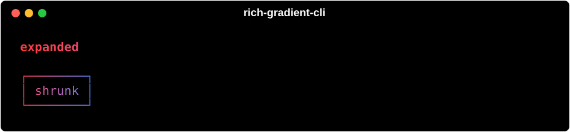

```bash
--8<-- "docs/snippets/options/padding.sh"
```

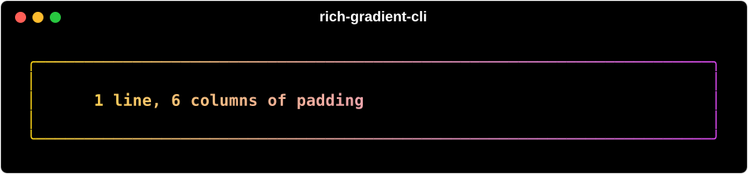

```bash
--8<-- "docs/snippets/options/panel-boxes.sh"
```

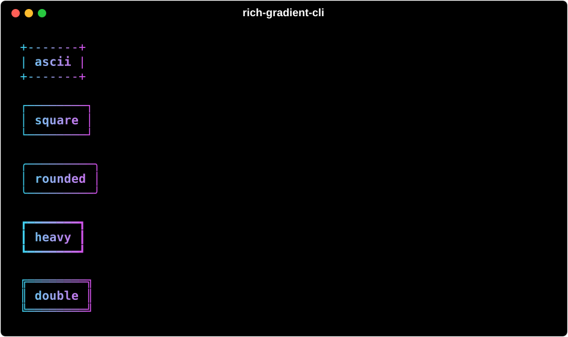

```bash
--8<-- "docs/snippets/options/panel-style.sh"
```


```bash
--8<-- "docs/snippets/options/title-caption.sh"
```

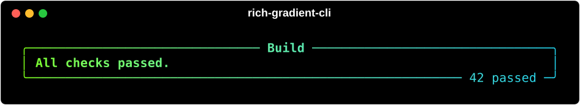

## Content

| Option | Description |
|---|---|
| `-s`, `--style STYLE` | Rich style applied to the text, e.g. `bold` or `italic underline`. |
| `--markup` / `--no-markup` | Parse Rich console markup (on by default). |
| `-j`, `--emoji` | Replace emoji codes such as `:sparkles:`. |
| `-y`, `--hyperlinks` | Render hyperlinks in Markdown. |
| `--no-wrap` | Don't word-wrap text or code. |
| `--tab-size N` | Tab width. Default `4`. |
| `-h`, `--head LINES` / `-t`, `--tail LINES` | Show only the first or last LINES (syntax, CSV and notebooks). |
| `-x`, `--lexer LEXER` | Pygments lexer for code. |
| `--theme THEME` | Pygments theme for code. Can also be set with `RICH_THEME`. Default `monokai`. |
| `-n`, `--line-numbers` | Show line numbers in code. |
| `-g`, `--guides` | Show indentation guides in code and JSON. |
| `--rule-style STYLE` | Style for `--rule`. |
| `--rule-char CHARACTER` | Single character to draw `--rule` with (overrides `--thickness`). |
| `--thickness 0-3` | Rule thickness. Default `2`. |
| `--delimiter CHAR` | CSV delimiter. Auto-detected by default. |
| `--no-header` | Treat the first CSV row as data. |
| `--max-depth N` | How many directory levels `--tree` shows. Default `2`. |
| `--spectrum-output table\|names\|hex\|csv` | Output format for `--spectrum`. |

```bash
--8<-- "docs/snippets/options/style.sh"
```


```bash
--8<-- "docs/snippets/options/no-markup.sh"
```

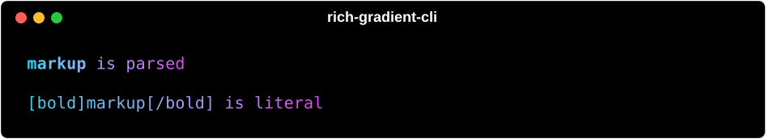

```bash
--8<-- "docs/snippets/options/emoji.sh"
```


```bash
--8<-- "docs/snippets/options/head-tail.sh"
```

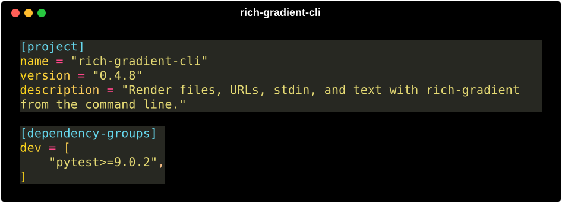

```bash
--8<-- "docs/snippets/options/lexer-theme.sh"
```

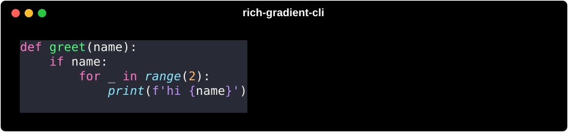

```bash
--8<-- "docs/snippets/options/line-numbers.sh"
```

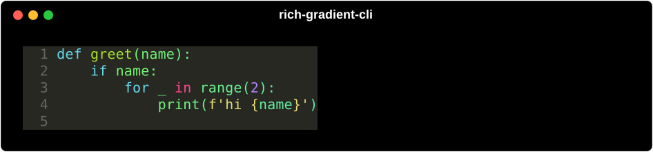

```bash
--8<-- "docs/snippets/options/guides.sh"
```

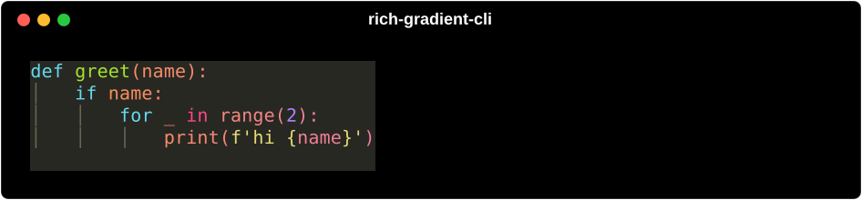

```bash
--8<-- "docs/snippets/options/rule-style.sh"
```

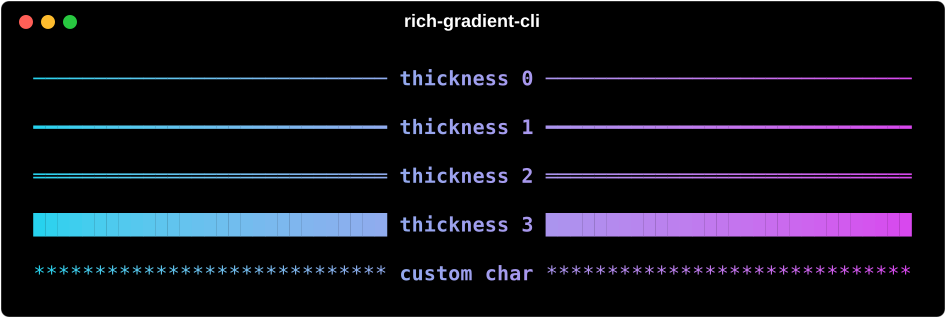

```bash
--8<-- "docs/snippets/options/delimiter.sh"
```

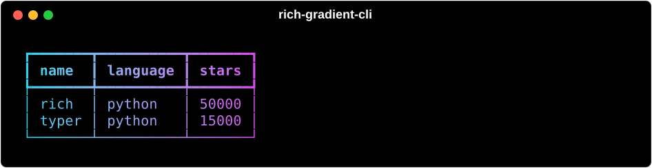

```bash
--8<-- "docs/snippets/options/no-header.sh"
```

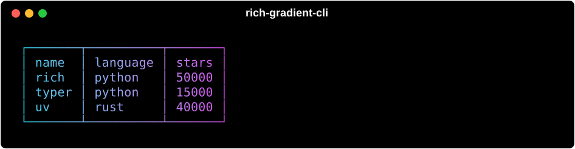

```bash
--8<-- "docs/snippets/options/max-depth.sh"
```

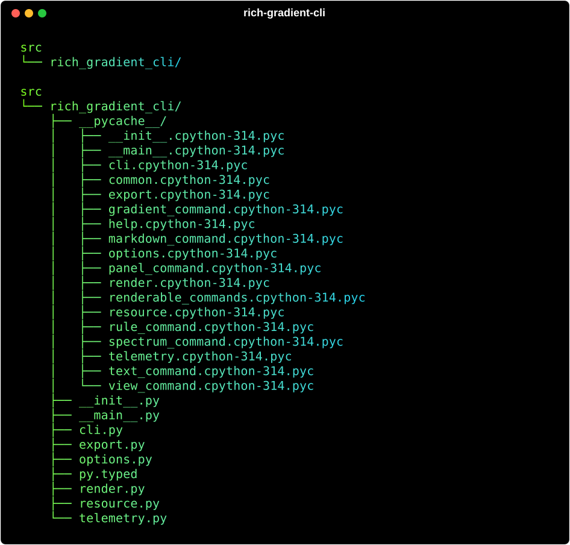

```bash
--8<-- "docs/snippets/options/spectrum-output.sh"
```

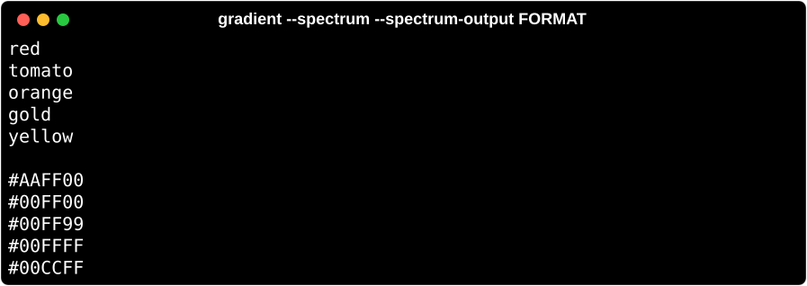

## Output

| Option | Description |
|---|---|
| `-o`, `--export-html PATH` | Also write the output to PATH as HTML. |
| `--export-svg PATH` | Also write the output to PATH as SVG. |
| `--pager` | Show the output in an interactive pager. |
| `--force-terminal` | Keep colors (ANSI codes) even when not writing to a terminal. |
| `--telemetry enable\|disable\|status` | Manage opt-in anonymous usage telemetry, then exit. |
| `-v`, `--version` | Print the version and exit. |

## Warnings

Some options only apply to certain renderables. When an option has no effect, `gradient` prints a warning to stderr and carries on. For example, `--head` with Markdown, `--title` without `--panel`, or `--panel` with `--rule`.

## Exit codes

| Code | Meaning |
|---|---|
| `0` | Success. |
| `1` | Runtime error: unreadable file, HTTP failure, invalid JSON or markup, and so on. |
| `2` | Usage error: conflicting flags, or an invalid color, style, regex or padding. |
