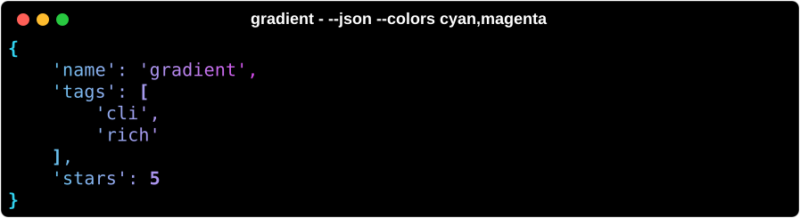
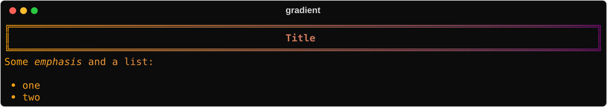
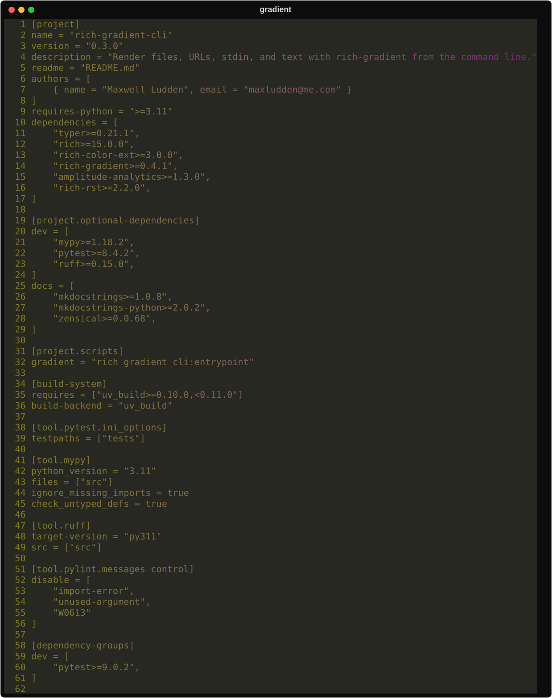
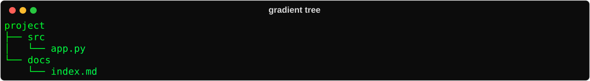
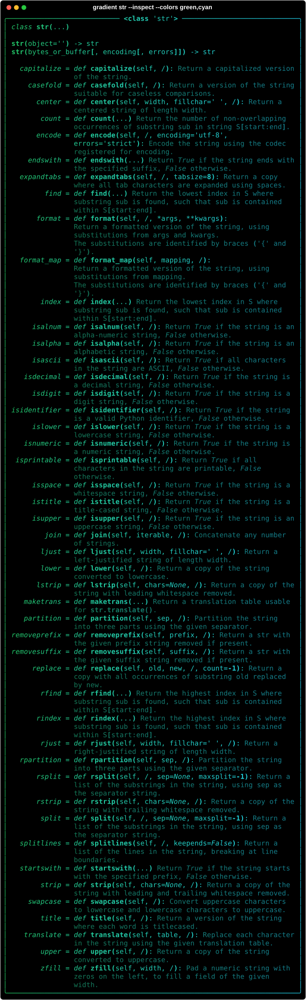

# Usage

## Installation

```bash
uv tool install rich-gradient-cli     # or: pip install rich-gradient-cli
```

## Text

Literal text and stdin are printed as gradient text. Rich console markup is parsed unless you pass `--no-markup`.

```bash
gradient --colors 'red,#ff9900,#ffff00' "Hello [b]gradient[/b]"
echo "piped text" | gradient - --colors cyan,magenta
```


Highlight words or patterns with `--highlight-word WORD=STYLE` and `--highlight-regex PATTERN=STYLE`:

```bash
gradient --colors magenta,cyan --highlight-word 'error=bold white on red' "Highlight error text"
```


## Files and URLs

The mode is picked from the extension; any other file is syntax-highlighted. `http(s)://` URLs and `-` (stdin) work everywhere.

```bash
gradient README.md
gradient doc.rst
gradient notebook.ipynb
gradient data.csv
gradient config.json
gradient pyproject.toml -n -g --head 20
gradient https://example.com/page.md
```







## Panels and rules

`--panel BOX` wraps any renderable in a gradient panel (`ascii`, `ascii2`, `square`, `rounded`, `heavy`, `double`, `none`). `--rule` draws a rule titled with the text.

```bash
gradient "Something went wrong" --panel rounded --title Error --colors red,'#ff9999'
gradient "Section" --rule --colors blue,cyan
```


## Trees, columns, spectrum and inspect

```bash
gradient --tree src
printf 'a\nb\nc\n' | gradient - --columns
gradient --spectrum --hues 7 --spectrum-output hex
gradient str --inspect
```




## Animation

`--animate` animates the gradient in an interactive terminal (add `--duration SECONDS` to stop automatically). When output is not a terminal, a single static frame is printed. It cannot be combined with `--export-*` or `--pager`.

## Export and paging

```bash
gradient README.md --export-svg readme.svg
gradient README.md -o readme.html
gradient README.md --pager
```

## Telemetry

Off by default. `gradient --telemetry enable|disable|status`; events are sent only when `AMPLITUDE_API_KEY` is also set.
